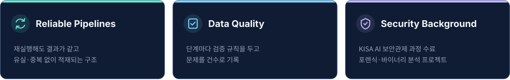

  

데이터가 빠지거나 중복되지 않고, 다시 돌려도 같은 결과가 나오는 파이프라인을 만드는 데 관심이 많습니다.

이화여자대학교 화학·나노과학과 졸업 (소프트웨어 융합연계전공 복수전공) 
SKALA 4기 AI·데이터 과정 수강 중 · 한국인터넷진흥원(KISA) AI 보안관제 전문인력 양성과정 8기 수료

 

  

  

<table>
<tr>
<td align="center" width="80"> Python</td>
<td align="center" width="80"> Java</td>
<td align="center" width="80"> PostgreSQL</td>
<td align="center" width="80"> Kafka</td>
<td align="center" width="80"> Docker</td>
</tr>
<tr>
<td align="center" width="80"> Spring</td>
<td align="center" width="80"> FastAPI</td>
<td align="center" width="80"> PyTorch</td>
<td align="center" width="80"> scikit-learn</td>
<td align="center" width="80"> SQLite</td>
</tr>
</table>

 

## Projects

<table>
<tr>
<td width="50%" valign="top">

### [[kpi-sentinel](https://github.com/ahrdyrxkddhfl/kpi-sentinel)]
**실시간 KPI 이상 감지 파이프라인** 
Solo · Python · Kafka(Redpanda) · PostgreSQL · DuckDB

- 계절성을 반영해 오탐 77% 감소, 장애 미탐 0건
- 컨슈머를 강제 종료해도 유실·중복 없이 적재되는지 검증

</td>
<td width="50%" valign="top">

### [[mfds-drug-pipeline](https://github.com/ahrdyrxkddhfl/mfds-drug-pipeline)]
**식약처 의약품 공공데이터 파이프라인** 
Solo · Python · PostgreSQL · Docker Compose

- 허가정보 42,980건을 제품 42,885개로 정규화
- 품질 검증 규칙 8종, 여러 번 돌려도 같은 결과가 나오게 구성

</td>
</tr>
<tr>
<td width="50%" valign="top">

### [[claim-trace](https://github.com/ahrdyrxkddhfl/claim-trace)]
**AI 보험금 심사 근거 추적 시스템** 
Solo · Java 21 · Spring Boot · JPA · PostgreSQL

- AI 권고와 심사자 판정을 분리해 근거를 항목별로 기록
- 설계 불변조건 13개를 코드로 강제, 테스트 102개

</td>
<td width="50%" valign="top">

### [[taxi](https://github.com/SKALA-python/taxi)]
**NYC 로보택시 배차 전략** 
Team of 6 · Python · pandas · scikit-learn

- 운행 데이터 388만 건으로 수요·수익·효율 예측 모델 개발
- 모델 파트를 맡아 공통 규격을 정하고 세 모델 통합

</td>
</tr>
<tr>
<td width="50%" valign="top">

### [[SKALA_CNN-Optimization](https://github.com/ahrdyrxkddhfl/SKALA_CNN-Optimization)]
**웨이퍼맵 불량 분류 CNN 개선** 
Team of 2 · Python · PyTorch

- 과적합 원인을 파라미터 배치 문제로 진단
- Macro-F1 0.755 → 0.881, 파라미터 71% 감소

</td>
<td width="50%" valign="top">

### [[vibecheck](https://github.com/ahrdyrxkddhfl/vibecheck)]
**AI로 짠 코드 설명력 점검 도구** 
Solo · Python · tree-sitter · MCP · FastAPI

- 레포 Q&A, 면접 예상질문, 답변 채점까지 한 번에
- PyPI 배포 (`pip install vibecheck-whyd`)

</td>
</tr>
</table>

 

## Other Projects

**Security** &nbsp; [binary-analyzer-mcp](https://github.com/ahrdyrxkddhfl/binary-analyzer-mcp) · [evidence-trace](https://github.com/ahrdyrxkddhfl/evidence-trace) · [ForensicFileAnalyzer](https://github.com/ahrdyrxkddhfl/ForensicFileAnalyzer) · [CAN-ADS](https://github.com/ahrdyrxkddhfl/CAN-ADS) 
**Manufacturing** &nbsp; [wafer-lot-hold](https://github.com/ahrdyrxkddhfl/wafer-lot-hold) AI 검사 결과로 불량 Lot을 자동 정지하는 MES 기능 
**Tools** &nbsp; [crumb-tracker](https://github.com/ahrdyrxkddhfl/crumb-tracker) 바이브코딩 작업 기록을 작업일지로 정리하는 로컬 도구
