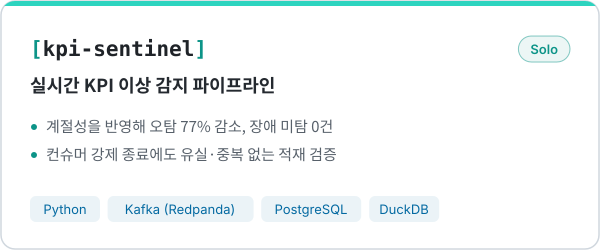
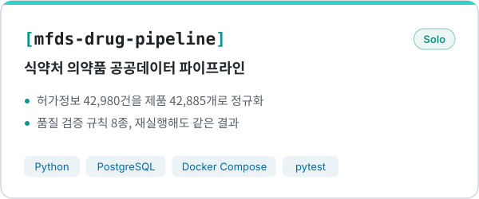
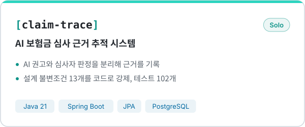
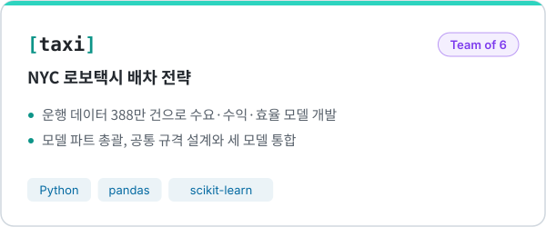
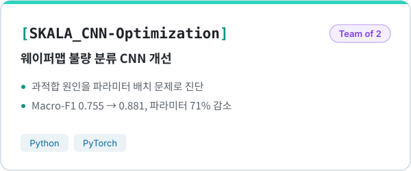
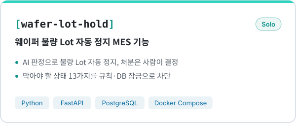

  

**AI와 사람이 믿고 쓸 수 있는 데이터를 만듭니다.**

이화여자대학교 화학·나노과학과 졸업 (소프트웨어 융합연계전공 복수전공) 
SKALA 4기 AI·데이터 과정 수강 중 · 한국인터넷진흥원(KISA) AI 보안관제 전문인력 양성과정 8기 수료

 

  

<picture><source media="(prefers-color-scheme: dark)" srcset="assets/focus-dark.svg"></picture>

  

<table>
<tr>
<td align="center" width="80"> Python</td>
<td align="center" width="80"> Java</td>
<td align="center" width="80"> PostgreSQL</td>
<td align="center" width="80"> Kafka (Redpanda)</td>
<td align="center" width="80"> Docker</td>
</tr>
<tr>
<td align="center" width="80"> Spring</td>
<td align="center" width="80"> FastAPI</td>
<td align="center" width="80"> PyTorch</td>
<td align="center" width="80"> scikit-learn</td>
<td align="center" width="80"> SQLite</td>
</tr>
</table>

 

## Projects

<a href="https://github.com/ahrdyrxkddhfl/kpi-sentinel"><picture><source media="(prefers-color-scheme: dark)" srcset="assets/projects/kpi-sentinel-dark.svg"></picture></a>
<a href="https://github.com/ahrdyrxkddhfl/mfds-drug-pipeline"><picture><source media="(prefers-color-scheme: dark)" srcset="assets/projects/mfds-drug-pipeline-dark.svg"></picture></a>

<a href="https://github.com/ahrdyrxkddhfl/claim-trace"><picture><source media="(prefers-color-scheme: dark)" srcset="assets/projects/claim-trace-dark.svg"></picture></a>
<a href="https://github.com/SKALA-python/taxi"><picture><source media="(prefers-color-scheme: dark)" srcset="assets/projects/taxi-dark.svg"></picture></a>

<a href="https://github.com/ahrdyrxkddhfl/SKALA_CNN-Optimization"><picture><source media="(prefers-color-scheme: dark)" srcset="assets/projects/SKALA_CNN-Optimization-dark.svg"></picture></a>
<a href="https://github.com/ahrdyrxkddhfl/wafer-lot-hold"><picture><source media="(prefers-color-scheme: dark)" srcset="assets/projects/wafer-lot-hold-dark.svg"></picture></a>

 

## Other Projects

**Security** &nbsp; [binary-analyzer-mcp](https://github.com/ahrdyrxkddhfl/binary-analyzer-mcp) · [evidence-trace](https://github.com/ahrdyrxkddhfl/evidence-trace) · [ForensicFileAnalyzer](https://github.com/ahrdyrxkddhfl/ForensicFileAnalyzer) · [CAN-ADS](https://github.com/ahrdyrxkddhfl/CAN-ADS) 
**Tools** &nbsp; [vibecheck](https://github.com/ahrdyrxkddhfl/vibecheck) AI로 짠 코드를 설명할 수 있는지 확인하는 면접 연습 도구 · [crumb-tracker](https://github.com/ahrdyrxkddhfl/crumb-tracker) 바이브코딩 작업 기록 정리 도구
